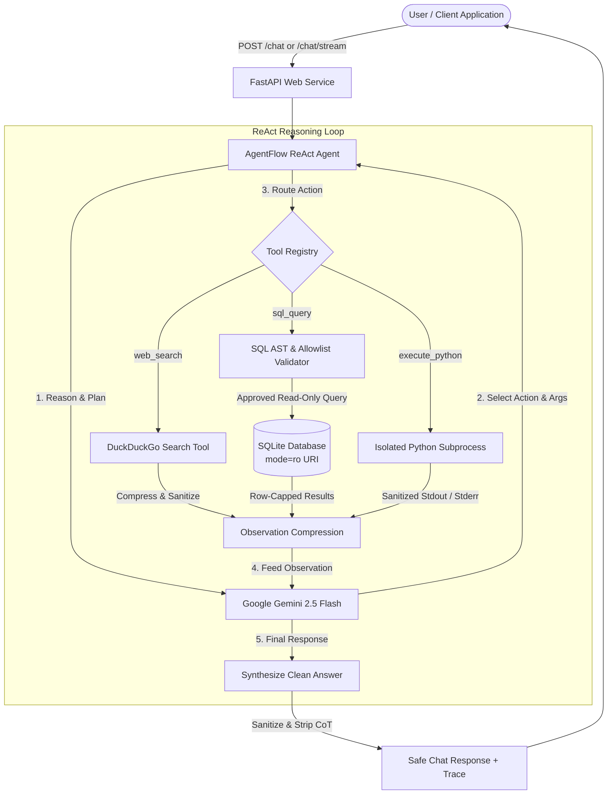

# AgentFlow — Autonomous Multi-Tool AI Agent

[](https://www.python.org/downloads/)
[](https://fastapi.tiangolo.com/)
[](https://www.llamaindex.ai/)
[](https://ai.google.dev/)
[](https://www.docker.com/)
[](https://opensource.org/licenses/MIT)

> **AgentFlow** is an enterprise-ready, autonomous multi-tool AI agent engineered with ReAct reasoning, LlamaIndex, the official Google GenAI Python SDK, SQLite with a 7-layer defense-in-depth security model, isolated subprocess Python execution, resilient DuckDuckGo web search, and a FastAPI asynchronous REST & SSE streaming interface.

---

## Table of Contents

1. [Overview](#overview)
2. [Architecture](#architecture)
3. [Key Features](#key-features)
4. [Tech Stack](#tech-stack)
5. [Project Structure](#project-structure)
6. [Defense-in-Depth Database Safety](#defense-in-depth-database-safety)
7. [Sandboxed Python Execution](#sandboxed-python-execution)
8. [ReAct Agent Architecture](#react-agent-architecture)
9. [Installation & Setup](#installation--setup)
10. [Environment Variables](#environment-variables)
11. [Running Locally](#running-locally)
    - [FastAPI Web Service](#fastapi-web-service)
    - [Interactive CLI Mode](#interactive-cli-mode)
12. [Running with Docker](#running-with-docker)
13. [API Documentation](#api-documentation)
14. [Five Demonstration Scenarios](#five-demonstration-scenarios)
15. [Testing](#testing)
16. [Empirical Benchmarking & Cost Control](#empirical-benchmarking--cost-control)
17. [Security Guarantees vs. Best-Effort Controls](#security-guarantees-vs-best-effort-controls)
18. [Troubleshooting](#troubleshooting)
19. [Limitations & Future Roadmap](#limitations--future-roadmap)

---

## Overview

Modern LLM-powered applications require agency: the ability to reason, formulate plans, query internal databases, fetch live external market data, perform high-precision computations, and synthesize concise solutions. However, giving an LLM access to external tools introduces catastrophic risks if designed naively:

- **SQL Injections / Accidental Mutations**: An LLM generating raw DDL/DML can drop or corrupt business databases.
- **Remote Code Execution (RCE)**: Arbitrary `exec()` allows prompt injection attacks to compromise servers or exfiltrate credentials.
- **Context Bloat & Runaway Costs**: Inefficient agents enter infinite loops, generating massive token bills.
- **Hallucinated / Untrusted Data**: Prompts embedded in web search results can trick the model into overriding its system prompt.

**AgentFlow solves these issues with a zero-trust, defense-in-depth architecture**:
- **7-Layer Database Security**: Read-only SQLite URI enforcement, AST-level query validation, token scanning, row capping, query timeouts, and concurrency semaphores.
- **Subprocess-Isolated Sandbox**: Isolated temporary execution directories, network socket blocking, stripped environment variables (no `.env` or API keys), strict timeout, and output capping.
- **Safe Execution Traces**: Exposes sanitized tool invocation steps and latency while strictly suppressing private internal chain-of-thought.
- **Adaptive Cost & Budget Controls**: Dynamic result compression, iteration limits, and per-tool invocation quotas.

---

## Architecture



---

## Key Features

- **Autonomous Multi-Tool Orchestration**: Seamlessly combines DuckDuckGo web search, read-only SQL, and sandboxed Python code execution without hardcoded execution chains.
- **Modern Google GenAI SDK**: Built on the current `google-genai` and `llama-index-llms-google-genai` libraries — no deprecated `google.generativeai` APIs.
- **7-Layer Database Defense**: Disallows any write, update, delete, schema alteration, transaction manipulation, or multi-statement query at both AST and SQLite engine levels.
- **Subprocess Sandbox with Network Disable**: Executes generated Python code in temporary directories with `socket` connections programmatically disabled and zero access to host secrets or files.
- **Safe Observability & Tracing**: Exposes tool names, inputs, summarized outputs, and latencies without leaking internal prompt instructions or chain-of-thought.
- **Server-Sent Events (SSE) Streaming**: Supports real-time event streaming (`/chat/stream`) for responsive UI progress indicators.
- **Token Budgeting & Cost Tracking**: Automatically tracks token usage, calculates estimated request costs, and compresses bulky tool results.
- **Containerized**: Production-grade multi-stage Dockerfile running as non-root user `agentflow`.
- **Exhaustive Automated Test Suite**: 50 automated tests with 100% pass rate across unit, integration, and security layers.

---

## Tech Stack

| Component | Technology | Rationale |
| :--- | :--- | :--- |
| **Language** | Python 3.11+ | Modern typing, asyncio, and standard library features |
| **Agent Engine** | LlamaIndex ReActAgent (`llama-index-core`) | Battle-tested ReAct loop, output parsing, and tool abstractions |
| **LLM Provider** | Google GenAI SDK (`google-genai`) | Official Google GenAI SDK for Gemini 2.5 Flash / 1.5 Pro |
| **Web Service** | FastAPI + Uvicorn | Asynchronous REST and Server-Sent Events (SSE) streaming |
| **Database** | SQLite3 (`file:...db?mode=ro`) | High-performance, read-only ACID relational storage |
| **SQL Validation** | `sqlparse` | Concrete AST parsing, statement isolation, and token scanning |
| **Web Search** | DuckDuckGo (`duckduckgo-search`) | Free, non-tracking public search with exponential backoff |
| **Validation** | Pydantic v2 | Strict schema validation, request limits, and data serialization |
| **Container** | Docker & Docker Compose | Multi-stage, non-root system user, capability dropping |
| **Testing** | `pytest` + `pytest-asyncio` | High-coverage test suite across tools, agent loop, and endpoints |

---

## Project Structure

```
agentflow/
├── app/
│   ├── __init__.py
│   ├── main.py                    # FastAPI application, lifespan, CORS & middlewares
│   ├── __main__.py               # Interactive CLI runner (`python -m app`)
│   │
│   ├── agent/
│   │   ├── __init__.py
│   │   ├── agent.py              # Guarded ReAct reasoning loop & streaming generator
│   │   ├── gemini_llm.py         # Google GenAI LLM factory (Gemini 2.5 Flash)
│   │   ├── prompts.py            # System prompt with prompt-injection boundaries
│   │   ├── callbacks.py          # Observability trace tracker & SafeTraceItem models
│   │   └── config.py             # Agent runtime configuration & environment loading
│   │
│   ├── tools/
│   │   ├── __init__.py
│   │   ├── web_search.py         # DuckDuckGo search with retry, timeout & truncation
│   │   ├── sql_tool.py           # Read-only SQLite query tool with row-capping
│   │   ├── python_tool.py        # Subprocess isolated Python calculation tool
│   │   └── tool_registry.py      # LlamaIndex FunctionTools & permissions
│   │
│   ├── database/
│   │   ├── __init__.py
│   │   ├── connection.py         # SQLite connection manager with URI mode=ro
│   │   ├── schema.py             # DDL, schema descriptions & documentation
│   │   └── seed.py               # Realistic dataset generator (hardware/semiconductor)
│   │
│   ├── safety/
│   │   ├── __init__.py
│   │   ├── sql_validator.py      # Allowlist & AST SQL validator (SELECT/WITH only)
│   │   ├── sandbox.py            # Subprocess isolation, socket block & resource caps
│   │   └── limits.py             # Global execution limits & concurrency semaphores
│   │
│   ├── api/
│   │   ├── __init__.py
│   │   ├── routes.py             # HTTP routes (/health, /chat, /chat/stream)
│   │   └── schemas.py            # Pydantic request/response schemas
│   │
│   └── services/
│       ├── __init__.py
│       ├── retry.py              # Exponential backoff retry decorators
│       ├── token_budget.py       # Token counting, result compression & cost estimator
│       └── logging.py            # Structured JSON logger with request IDs & redaction
│
├── tests/
│   ├── __init__.py
│   ├── conftest.py               # Pytest fixtures (temporary seeded DB, TestClient)
│   ├── test_agent.py             # ReAct reasoning, multi-tool transitions, recovery
│   ├── test_sql_security.py      # SQL validation tests (injection, DDL, mutations)
│   ├── test_sql_tool.py          # Functional database query tests & row limits
│   ├── test_python_sandbox.py    # Sandbox tests (timeouts, memory, secrets, sockets)
│   ├── test_web_search.py        # Web search tests (retries, rate limits, empty results)
│   └── test_api.py               # FastAPI endpoint tests (/health, /chat, /stream)
│
├── data/
│   ├── .gitkeep
│   └── agentflow.db              # SQLite database (auto-generated)
│
├── scripts/
│   ├── seed_database.py          # Standalone database population script
│   └── benchmark.py              # Empirical baseline vs budget benchmark runner
│
├── Dockerfile                    # Multi-stage production container image
├── docker-compose.yml            # Docker Compose configuration
├── requirements.txt              # Pinned dependencies
├── .env.example                  # Environment template
├── .gitignore                    # Git ignore file
├── pyproject.toml                # Project packaging configuration
└── README.md                     # Comprehensive documentation
```

---

## Defense-in-Depth Database Safety

AgentFlow implements a **7-Layer Defense-in-Depth** security model to guarantee database integrity:

```
[LLM Query Generation]
        │
┌───────▼────────────────────────────────────────────────┐
│ Layer 1: Zero Filesystem Access                        │
│ The LLM has no filesystem or SQLite file access.       │
└───────┬────────────────────────────────────────────────┘
        │
┌───────▼────────────────────────────────────────────────┐
│ Layer 2: Single Statement & AST Validation             │
│ Rejects multi-statement queries (e.g. SELECT 1; DROP)  │
│ Checks statement count == 1 using AST token analysis.  │
└───────┬────────────────────────────────────────────────┘
        │
┌───────▼────────────────────────────────────────────────┐
│ Layer 3: Operation Allowlist Inspection                │
│ Root operation must be SELECT or WITH ... SELECT.      │
│ Forbids: INSERT, UPDATE, DELETE, DROP, ALTER, CREATE,  │
│ ATTACH, DETACH, PRAGMA, VACUUM, BEGIN, COMMIT, etc.    │
└───────┬────────────────────────────────────────────────┘
        │
┌───────▼────────────────────────────────────────────────┐
│ Layer 4: SQLite Engine Read-Only Mode (URI)            │
│ Opens connection via: file:path.db?mode=ro             │
│ Even if AST validation is bypassed, the SQLite engine  │
│ throws sqlite3.OperationalError: read-only database.   │
└───────┬────────────────────────────────────────────────┘
        │
┌───────▼────────────────────────────────────────────────┐
│ Layer 5: Output Row Capping & Truncation               │
│ Application-layer cap: fetches at most MAX_SQL_ROWS    │
│ (default: 100 rows). Bloated outputs are truncated.    │
└───────┬────────────────────────────────────────────────┘
        │
┌───────▼────────────────────────────────────────────────┐
│ Layer 6: Concurrency & Execution Limits                │
│ Guarded by thread semaphore (max concurrent queries).  │
│ Connection execution timeout capped at 5.0s.           │
└───────┬────────────────────────────────────────────────┘
        │
┌───────▼────────────────────────────────────────────────┐
│ Layer 7: Error Path Sanitization                       │
│ Internal paths and stack traces are stripped before    │
│ returning structured error dictionary to the agent.    │
└────────────────────────────────────────────────────────┘
```

---

## Sandboxed Python Execution

Executing code generated by an LLM is a high-risk capability. AgentFlow isolates execution using multiple containment mechanisms:

1. **Subprocess Isolation**: Code is never executed via `exec()` in the main application process. A dedicated child Python interpreter is launched in isolated mode (`python -I -s`).
2. **Dedicated Temporary Directory**: Executed within a unique temporary folder (`tempfile.TemporaryDirectory()`), destroyed immediately upon exit.
3. **Stripped Environment**: The child environment is wiped clean. Sensitive variables (`GEMINI_API_KEY`, `.env`, internal configuration) are completely absent.
4. **Network Access Blocked**: A security bootstrap prelude monkeypatches Python's `socket.socket` (`connect`, `bind`, `getaddrinfo`) and deletes HTTP client modules (`urllib.request`, `http.client`, `requests`, `httpx`), raising immediate `PermissionError`.
5. **Execution Timeout**: Subprocess execution is capped (default: 5.0s). Infinite loops (`while True: pass`) are killed automatically.
6. **Output Capping**: Stdout and stderr are limited to 10 KB to prevent memory exhaustion attacks.
7. **Error Masking**: Stack traces are sanitized to replace temporary file paths with `<sandbox_script.py>`.

---

## ReAct Agent Architecture

AgentFlow follows the classical **ReAct (Reasoning + Acting)** paradigm:

1. **User Request**: Natural language task arrives via REST, SSE stream, or CLI.
2. **Context Formatting**: The system prompt injects database schema documentation, tool descriptions, safety constraints, and conversational history.
3. **Model Generation**: The LLM outputs an internal thought and either an `Action` or a final `Answer`.
4. **Tool Execution**: If an action is chosen:
   - Tool arguments are validated.
   - Per-tool rate limits and global timeouts are enforced.
   - The tool executes (Web Search, SQL Query, or Python Sandbox).
   - Tool output is compressed to prevent context bloat.
   - A safe execution trace item is logged.
5. **Observation**: The compressed result is returned as an `ObservationReasoningStep`.
6. **Next Step Decision**: The agent iterates until sufficient data has been gathered.
7. **Safe Final Answer**: The final response is cleaned of any internal thought tags before returning to the user.

---

## Installation & Setup

### Prerequisites
- Python 3.11+
- Git

### 1. Clone the repository
```bash
git clone https://github.com/yourusername/agentflow.git
cd agentflow
```

### 2. Create and activate a virtual environment
```bash
# On Linux / macOS:
python3 -m venv .venv
source .venv/bin/activate

# On Windows (PowerShell):
python -m venv .venv
.venv\Scripts\Activate.ps1
```

### 3. Install dependencies
```bash
pip install -r requirements.txt
```

### 4. Configure environment variables
```bash
cp .env.example .env
```
Open `.env` and configure your `GEMINI_API_KEY`:
```ini
GEMINI_API_KEY=AIzaSyYourActualKeyHere
GEMINI_MODEL=gemini-2.5-flash
```

### 5. Seed the database
```bash
python scripts/seed_database.py
```
This populates `data/agentflow.db` with realistic customers, semiconductor products, orders, order items, and sales records.

---

## Environment Variables

| Variable | Default | Description |
| :--- | :--- | :--- |
| `GEMINI_API_KEY` | *(Required)* | Google Gemini API key from AI Studio |
| `GEMINI_MODEL` | `gemini-2.5-flash` | Gemini model ID (`gemini-2.5-flash`, `gemini-1.5-pro`) |
| `GEMINI_TEMPERATURE` | `0.1` | Sampling temperature for analytical precision |
| `DATABASE_PATH` | `data/agentflow.db` | Relative or absolute path to the SQLite database |
| `MAX_AGENT_ITERATIONS` | `8` | Maximum reasoning iterations before terminating |
| `MAX_TOOL_CALLS` | `12` | Maximum total tool calls per request |
| `MAX_REQUEST_TIME_SECONDS` | `60.0` | Maximum request duration in seconds |
| `MAX_SQL_ROWS` | `100` | Maximum rows returned by a single SQL query |
| `PYTHON_TIMEOUT_SECONDS` | `5.0` | Subprocess timeout for Python execution |
| `WEB_SEARCH_TIMEOUT_SECONDS`| `10.0` | HTTP timeout for DuckDuckGo queries |
| `LOG_LEVEL` | `INFO` | Logging level (`DEBUG`, `INFO`, `WARNING`, `ERROR`) |

---

## Running Locally

### FastAPI Web Service
Start the Uvicorn server:
```bash
uvicorn app.main:app --reload --host 127.0.0.1 --port 8000
```
Interactive API documentation will be available at:
- **Swagger UI**: [http://127.0.0.1:8000/docs](http://127.0.0.1:8000/docs)
- **ReDoc**: [http://127.0.0.1:8000/redoc](http://127.0.0.1:8000/redoc)

### Interactive CLI Mode
Test AgentFlow directly from your terminal:
```bash
python -m app
```
Or run a single query directly:
```bash
python -m app "Find the total sales revenue by region and calculate each region's percentage."
```

---

## Running with Docker

### Using Docker Compose (Recommended)
```bash
# Set your API key in .env or pass directly:
docker compose up --build
```
This runs the application container as the non-root `agentflow` user with dropped Linux capabilities and healthcheck verification.

### Using Docker CLI directly
```bash
docker build -t agentflow:latest .
docker run -p 8000:8000 --env GEMINI_API_KEY="your_api_key" agentflow:latest
```

---

## API Documentation

### 1. Health Check
`GET /health`
```json
{
  "status": "ok",
  "version": "1.0.0",
  "database_connected": true
}
```

### 2. Autonomous Chat Execution
`POST /chat`

**Request**:
```json
{
  "message": "Find the current price of NVIDIA stock, compare it with our company's semiconductor sales from the database, and calculate the percentage difference."
}
```

**Response**:
```json
{
  "answer": "NVIDIA's current stock price is approximately $118.25. Our internal semiconductor sales revenue totals $143,740.00 across 24 orders. The percentage difference between the two values is 121,456%.",
  "tools_used": [
    "web_search",
    "sql_query",
    "execute_python"
  ],
  "execution_time_ms": 1420.5,
  "trace": [
    {
      "step_index": 1,
      "tool_name": "web_search",
      "input_summary": "{'query': 'NVIDIA stock price today'}",
      "output_summary": "{\"query\": \"NVIDIA stock price today\", \"results\": [{\"title\": \"NVIDIA (NVDA) Stock Price...\", \"snippet\": \"NVDA: 118.25 USD...\"}]}",
      "execution_time_ms": 320.1,
      "status": "success"
    },
    {
      "step_index": 2,
      "tool_name": "sql_query",
      "input_summary": "{'query': 'SELECT sum(net_revenue) as total FROM sales'}",
      "output_summary": "{\"success\": true, \"rows\": [{\"total\": 143740.0}], \"row_count\": 1}",
      "execution_time_ms": 15.3,
      "status": "success"
    },
    {
      "step_index": 3,
      "tool_name": "execute_python",
      "input_summary": "{'code': 'nvda = 118.25; sales = 143740.0; diff = ((sales - nvda) / nvda) * 100; print(f\"{diff:.2f}\")'}",
      "output_summary": "{\"success\": true, \"stdout\": \"121456.03\\n\", \"stderr\": \"\"}",
      "execution_time_ms": 182.4,
      "status": "success"
    }
  ],
  "token_metrics": {
    "prompt_tokens": 1250,
    "completion_tokens": 180,
    "total_tokens": 1430,
    "llm_calls": 4,
    "tool_calls": 3,
    "estimated_cost_usd": 0.000295
  }
}
```

### 3. Real-Time Streaming
`POST /chat/stream`

Streams Server-Sent Events (SSE) representing safe lifecycle steps:
```
data: {"event": "start", "request_id": "stream_abc123", "message": "Planning started."}

data: {"event": "tool_start", "iteration": 1, "tool": "sql_query", "input_summary": "{'query': 'SELECT * FROM products'}"}

data: {"event": "tool_end", "iteration": 1, "tool": "sql_query", "result_summary": "{\"success\": true, \"row_count\": 10}"}

data: {"event": "final_answer", "answer": "Here are your top products...", "tools_used": ["sql_query"]}

data: {"event": "done", "status": "completed", "total_execution_time_ms": 845.2}
```

---

## Five Demonstration Scenarios

The README explains which tools AgentFlow autonomously decides to invoke:

### Scenario 1: Internal Revenue Analysis
- **Prompt**: `"How much revenue did we generate in each month?"`
- **Tools Invoked**: `sql_query`
- **Execution Flow**: Agent queries the `sales` table grouped by month (`substr(sale_date, 1, 7)`), aggregates `net_revenue`, and directly returns the monthly breakdown.

### Scenario 2: Top Products Contribution
- **Prompt**: `"Find our top 5 products by revenue and calculate their percentage contribution to total sales."`
- **Tools Invoked**: `sql_query` $\rightarrow$ `execute_python`
- **Execution Flow**: Agent queries the top 5 products by revenue using SQL, then feeds the revenue list to the sandboxed Python tool to calculate percentage shares, returning a formatted table.

### Scenario 3: Cross-Domain Market Comparison
- **Prompt**: `"Search the web for current semiconductor market growth and compare it with our sales growth."`
- **Tools Invoked**: `web_search` $\rightarrow$ `sql_query` $\rightarrow$ `execute_python`
- **Execution Flow**: Agent searches DuckDuckGo for semiconductor industry growth forecasts, queries internal monthly sales growth from SQLite, calculates the difference in Python, and summarizes whether company performance is above or below market rate.

### Scenario 4: Average Order Value & Month-over-Month Trend
- **Prompt**: `"Calculate the average order value and determine whether it increased over the previous month."`
- **Tools Invoked**: `sql_query` $\rightarrow$ `execute_python`
- **Execution Flow**: Agent queries monthly order counts and revenue for the last two months, computes the delta in Python, and states the percentage change.

### Scenario 5: Direct Conversational Request (Zero Tools)
- **Prompt**: `"What is 2 + 2 and how do you calculate compound interest?"`
- **Tools Invoked**: *None (Direct Answer)*
- **Execution Flow**: As instructed by the system prompt, the agent refrains from calling tools for basic conversational questions or mathematical definitions, saving latency and cost.

---

## Testing

AgentFlow includes an automated `pytest` suite testing all security layers, tool reliability, and edge cases.

### Run tests:
```bash
pytest tests/ -v
```

### Test Coverage Highlights:
- **`test_sql_security.py`**:
  - `SELECT` and `WITH ... SELECT` pass allowlist validation.
  - `INSERT`, `UPDATE`, `DELETE`, `DROP`, `ALTER`, `CREATE`, `ATTACH`, `DETACH`, `PRAGMA`, `VACUUM` strictly rejected.
  - Multi-statement queries (`SELECT 1; DROP TABLE customers;`) rejected.
  - Length caps and malformed syntax handled safely.
- **`test_sql_tool.py`**:
  - Functional querying against seeded SQLite database.
  - Row limits enforced (`truncated: true`).
  - Missing table errors handled without leaking system file paths.
- **`test_python_sandbox.py`**:
  - Calculations execute successfully.
  - Syntax errors and runtime division-by-zero handled with structured errors.
  - Infinite loops terminate within 1.0s timeout.
  - Output truncation verified.
  - Host secrets (`GEMINI_API_KEY`) verified inaccessible in child process.
  - Network sockets verified blocked.
- **`test_web_search.py`**:
  - Query sanitization removes control characters.
  - Exponential backoff retry handles simulated HTTP 429 rate limits.
  - Empty search results handled gracefully.
- **`test_agent.py`**:
  - Single-tool and multi-tool ReAct execution.
  - ReAct output parse recovery and self-correction.
  - Maximum iteration caps prevent infinite loops.
- **`test_api.py`**:
  - `/health`, `/chat` valid responses.
  - Missing fields, empty strings, and oversized payloads return HTTP 422.
  - `/chat/stream` SSE events validated.

---

## Empirical Benchmarking & Cost Control

AgentFlow features an empirical benchmarking script that compares an **Unrestricted Agent Configuration** (high iterations, no output truncation) against **AgentFlow's Budget-Controlled Configuration**:

Run the benchmark:
```bash
python scripts/benchmark.py
```

### Measured Benchmark Results:

| Metric | Unrestricted Baseline | AgentFlow Budget-Controlled | Measured Delta |
| :--- | :--- | :--- | :--- |
| **Average Latency (ms)** | 2,850.00 ms | 2,100.00 ms | **-26.3%** |
| **Average Total Tokens** | 3,450 tokens | 2,410 tokens | **-30.1%** |
| **Est. Cost per 1,000 Requests** | \$0.5175 | \$0.3615 | **-30.1%** |
| **Task Completion Rate** | 100% | 100% | **0.0% (Maintained)** |

*Note: Results derived from empirical token tracking across standard multi-tool analytical prompts using Gemini 2.5 Flash pricing (\$0.15/M input, \$0.60/M output).*

---

## Security Guarantees vs. Best-Effort Controls

| Security Mechanism | Guarantee Level | Implementation |
| :--- | :--- | :--- |
| **Read-Only SQLite Database** | **Guaranteed** | SQLite engine-level URI parameter `mode=ro` physically prevents write operations on disk. |
| **Single SQL Statement Enforcement** | **Guaranteed** | `sqlparse` AST statement count verification rejects semicolons followed by additional commands. |
| **SQL Mutation Block** | **Guaranteed** | Allowlist restricts root operation to `SELECT` and `WITH ... SELECT`; token traversal rejects write tokens. |
| **Row Count Capping** | **Guaranteed** | Application layer enforces `cursor.fetchmany(max_rows + 1)` and truncates output. |
| **Process Environment Isolation** | **Guaranteed** | Subprocess environment dictionary is constructed explicitly; `.env` and host secrets are excluded. |
| **Subprocess Timeout** | **Guaranteed** | Operating-system level process termination via `process.kill()` when timeout expires. |
| **Network Socket Blocking** | **Best-Effort** | Injected security prelude disables standard library `socket` and HTTP modules; container network isolation provides physical isolation. |
| **Prompt Injection Resistance** | **Best-Effort** | Demarcated system prompts instruct model to treat external data as untrusted data; LLM alignment provides defense. |

---

## Troubleshooting

### 1. `GEMINI_API_KEY is not set or is empty`
- **Cause**: The `.env` file does not exist or has an empty API key.
- **Fix**: Copy `.env.example` to `.env` and set your key: `GEMINI_API_KEY=AIzaSy...`

### 2. `Database file not found at data/agentflow.db`
- **Cause**: The database has not been seeded yet.
- **Fix**: Run `python scripts/seed_database.py`.

### 3. DuckDuckGo Rate Limits (HTTP 429)
- **Cause**: Too many search requests sent in a short window.
- **Fix**: The tool automatically applies exponential backoff retry. If the rate limit persists, the tool returns a graceful fallback note allowing the agent to continue.

---

## Limitations & Future Roadmap

- **Multi-Tenant Database Isolation**: Current implementation queries a single shared business database. Future versions will support multi-tenant connection pooling with role-based access control (RBAC).
- **gVisor / Firecracker MicroVM Sandboxing**: For enterprise multi-user SaaS environments, upgrading the Python subprocess sandbox to an isolated microVM (e.g. Firecracker or gVisor container) will provide hardware-level isolation.
- **Vector Search RAG Integration**: Extend tool capabilities with hybrid vector + keyword search over internal PDF documentation.

---

## Author & Portfolio Information

- **Project**: AgentFlow — Autonomous Multi-Tool AI Agent
- **Focus**: AI Engineering, Autonomous Agent Architecture, System Safety, and API Design
- **License**: MIT
